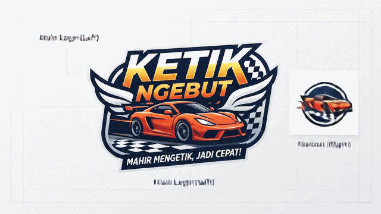
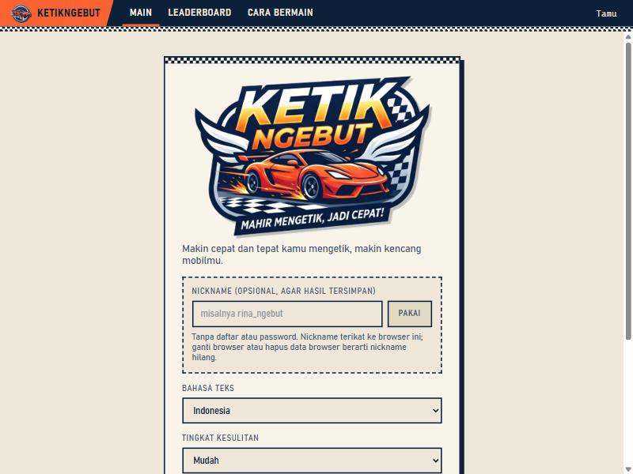
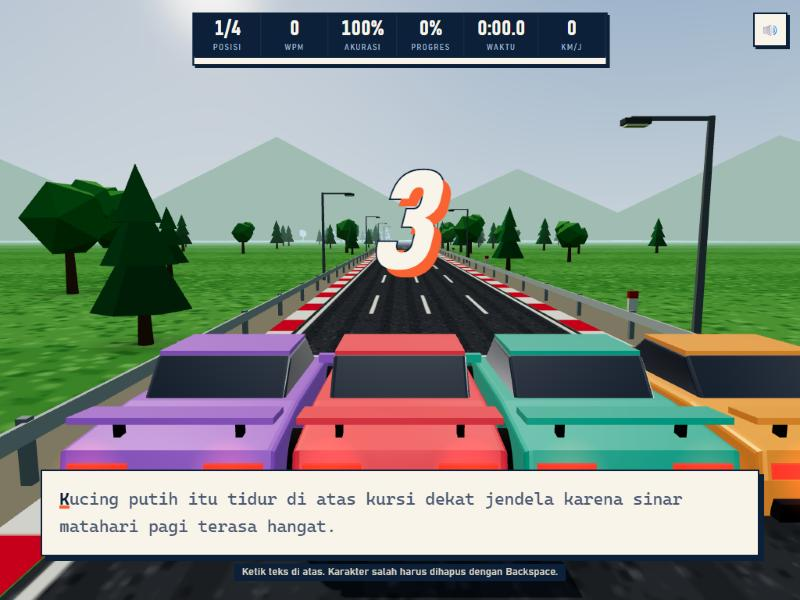
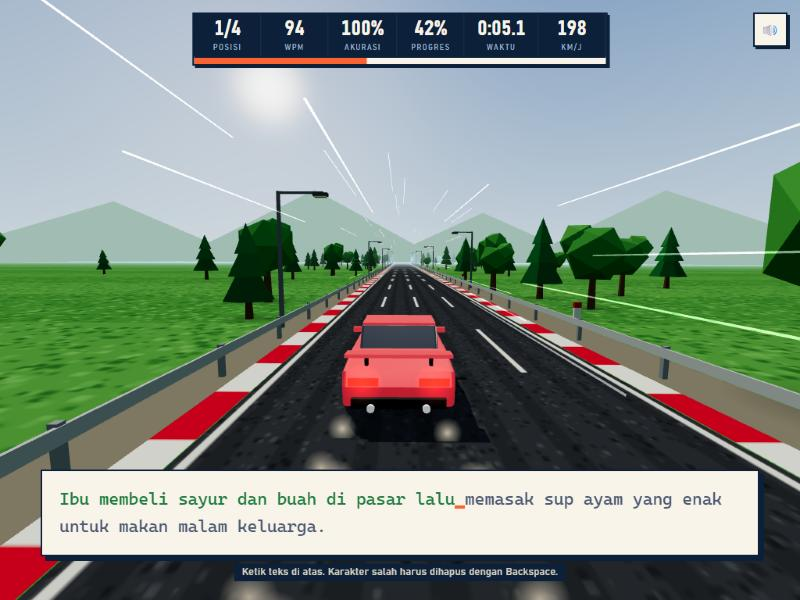
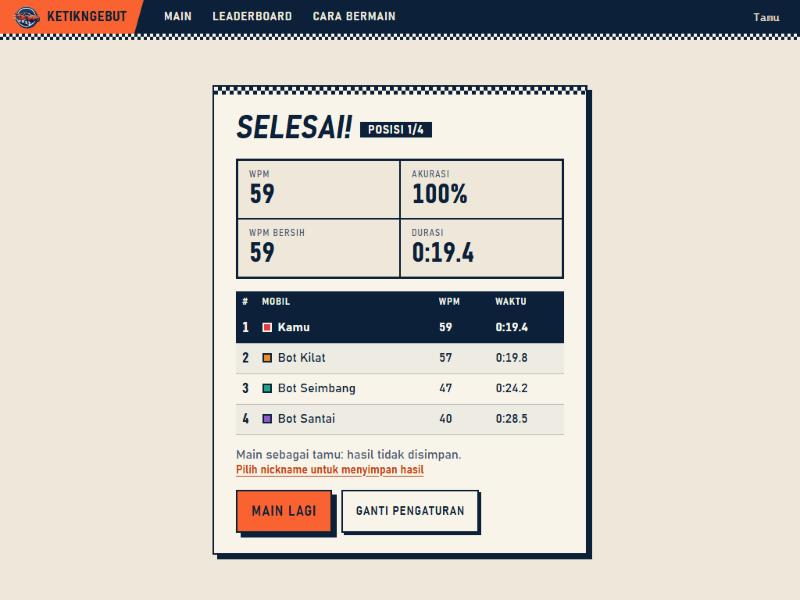

<p align="center">
  
</p>

<h3 align="center">Mahir mengetik, jadi cepat!</h3>

<p align="center">
  Game balap mobil 3D di browser yang mesinnya digerakkan oleh ketikanmu.
</p>

<p align="center">
  <a href="README.md">English</a> · <strong>Bahasa Indonesia</strong>
</p>

<p align="center">
  
  
  
  
  
</p>

---

## Kenapa game ini dibuat

Mengetik sepuluh jari adalah keterampilan yang sangat berguna, tapi latihannya membosankan, dan
kebanyakan orang berhenti sebelum benar-benar cepat. **KetikNgebut** mengubah latihan itu menjadi
balapan: setiap ketikan benar mendorong mobilmu maju, setiap salah ketik membuatnya tersendat, dan
berhenti mengetik membuat mobil melambat sampai berhenti. Kemajuan mengetikmu bukan lagi sekadar angka di
layar; kamu bisa *melihat* dan *merasakannya*.

Ini juga proyek belajar saya. Saya sudah menguasai React dan Three.js, dan memakai game ini untuk
belajar C#, ASP.NET Core, Entity Framework Core, serta keamanan di sisi server dengan sungguh-sungguh:
backend sungguhan dengan masalah anti-curang sungguhan, bukan sekadar aplikasi to-do.

## Cara bermain

1. **Pilih teks dan lawan.** Teks bahasa Indonesia atau Inggris, tiga tingkat kesulitan, dan bot dari
   *Pemula* (~28 WPM) sampai *Mahir* (~72 WPM).
2. **Mulai mengetik saat hitung mundur habis.** Kecepatan mobil mengikuti kecepatan ketikanmu beberapa
   detik terakhir. Huruf yang salah ditandai dan harus dihapus dengan Backspace sebelum bisa lanjut.
3. **Lewati garis finis.** Lihat WPM, akurasi, dan peringkat akhir keempat mobil. Pakai nickname agar
   hasilmu tersimpan, naik di leaderboard, dan balapan melawan *ghost* rekor terbaikmu sendiri.

## Tampilan

| Layar utama | Siap start: empat mobil berjajar |
|---|---|
|  |  |
| **Ngebut: makin cepat mengetik, makin kencang mobilnya** | **Hasil dan peringkat akhir** |
|  |  |

## Fitur

- **Mesin mengetik gaya TypeRacer.** Kursor tidak pernah melewati kesalahan; akurasi dan WPM dihitung
  dengan cara standar (5 karakter = 1 kata).
- **Selalu empat mobil.** Kamu melawan tiga bot (satu lebih lambat, satu setara, satu lebih cepat dari
  tingkat yang dipilih), masing-masing dengan ritme seperti manusia: jeda tidak rata, sesekali berhenti,
  dan kadang salah ketik.
- **Mode ghost.** Balapan melawan rekaman rekor terbaikmu sendiri, dibangun ulang dari log ketikannya.
- **Tanpa daftar.** Cukup pilih nickname dan main. Tamu juga bisa bermain, hanya saja hasilnya tidak
  disimpan.
- **Leaderboard yang adil.** Peringkat harian, mingguan, dan sepanjang masa, satu baris per pemain, dan
  semua skor dihitung ulang oleh server.
- **Statistik pribadi.** WPM rata-rata dan terbaik, akurasi, serta grafik perkembangan dari waktu ke waktu.
- **Latihan huruf lemah.** Game mencatat huruf yang paling sering salah dan membuat teks latihan berisi
  kata-kata yang mengandung huruf itu.
- **Suara.** Suara mesin, ketikan, dan salah ketik dibuat dengan Web Audio API, lengkap dengan tombol
  bisukan.
- **Pengaturan yang ikut kamu.** Bahasa, tingkat kesulitan, tingkat lawan, warna mobil, dan suara
  tersimpan per nickname (atau di browser untuk tamu).

## Sorotan teknis

Bagian yang paling saya banggakan, beserta alasannya:

- **Satu mesin mengetik, dua bahasa pemrograman, hasil identik.** Mesin mengetik adalah modul TypeScript
  murni (tanpa React dan Three.js). Saya port ke C# untuk server, lalu satu fixture JSON bersama diputar
  ulang oleh Vitest dan xUnit. Test membandingkan nilai WPM pecahan secara persis, sehingga browser dan
  server tidak mungkin berbeda pendapat soal skor.
- **Server tidak pernah memercayai klien.** Hasil yang dikirim hanya berisi id teks dan log ketikan.
  Server memutar ulang log itu dan menolak yang tidak wajar: kecepatan di atas batas yang dikonfigurasi,
  ritme ketikan yang terlalu rata atau terlalu cepat untuk manusia, waktu yang dimanipulasi, atau log yang
  sebenarnya tidak mengetik teks tersebut. Hasil yang ditolak disimpan untuk audit, tapi tidak pernah
  masuk leaderboard.
- **Game loop 60 FPS yang tidak bentrok dengan React.** Semua yang berubah setiap frame (fisika mobil,
  posisi bot, kamera) ada di objek biasa yang digerakkan `requestAnimationFrame`. React hanya me-render
  ulang HUD sekitar sepuluh kali per detik lewat store kecil di luar React.
- **Identitas tanpa password.** Nickname diklaim sekali dan diikat ke browser dengan token rahasia acak;
  server hanya menyimpan hash SHA-256-nya. Admin memakai ASP.NET Core Identity dengan JWT berumur pendek
  dan refresh token yang dirotasi serta mendeteksi pemakaian ulang.
- **Dirancang untuk server kecil.** Targetnya VPS 1 GB yang dipakai bersama situs lain, jadi cukup satu
  proses .NET dan SQLite mode WAL, dengan rate limiting, batas ukuran request, dan konfigurasi hemat
  memori.
- **Dites terhadap spesifikasi.** 276 test otomatis (130 xUnit, 146 Vitest). Nama setiap test memuat
  kode requirement yang diujinya, misalnya `RES_3_Wpm400_DitolakDanTidakMasukLeaderboard`.

## Teknologi

| Lapisan | Teknologi |
|---|---|
| Frontend | React 19, TypeScript (strict), Vite, Three.js, GSAP |
| Logika game | Modul TypeScript murni (mesin mengetik, bot, fisika), RNG berseed |
| Backend | C# 14, .NET 10, ASP.NET Core Minimal API |
| Data | Entity Framework Core dengan migration, SQLite (WAL) |
| Autentikasi | Token nickname (pemain), ASP.NET Core Identity + JWT (admin) |
| Test | xUnit + WebApplicationFactory, Vitest + Testing Library |

## Menjalankan di lokal

Kebutuhan: [.NET 10 SDK](https://dotnet.microsoft.com/download) dan [Node.js LTS](https://nodejs.org).

1. Buat kunci untuk development (disimpan di user-secrets .NET, tidak pernah masuk repositori):

   ```powershell
   dotnet user-secrets set "Jwt:SigningKey" "<string acak minimal 32 karakter>" --project src/KetikNgebut.Api
   ```

2. Jalankan backend (http://localhost:5288). Migration berjalan otomatis dan teks di-seed:

   ```powershell
   dotnet run --project src/KetikNgebut.Api --launch-profile http
   ```

3. Di terminal kedua, jalankan frontend (http://localhost:5173):

   ```powershell
   npm --prefix web install
   npm --prefix web run dev
   ```

4. Buka http://localhost:5173 dan mulai mengetik. Frontend juga bisa dipakai tanpa backend: kamu bisa
   main sebagai tamu dengan teks bawaan.

Menjalankan test:

```powershell
dotnet test
npm --prefix web test
```

## Struktur proyek

```
src/KetikNgebut.Api              Endpoint Minimal API, autentikasi, rate limiting
src/KetikNgebut.Application      Service, validasi hasil, DTO
src/KetikNgebut.Domain           Entitas dan port C# mesin mengetik
src/KetikNgebut.Infrastructure   DbContext EF Core, migration, Identity
tests/KetikNgebut.Tests          Unit test dan integration test xUnit
web/                             Frontend React + TypeScript + Three.js
shared/fixtures/                 Fixture bersama: mesin TypeScript == mesin C#
docs/PRD.md                      Dokumen kebutuhan produk
```

## Rencana

- [x] Mesin mengetik dan balapan satu pemain
- [x] Backend: identitas nickname, validasi hasil, leaderboard, dan statistik
- [x] Bot, tingkat kesulitan, dan mode ghost
- [x] Suara, latihan huruf lemah, pengaturan, dan tampilan responsif
- [ ] Deploy publik (VPS Ubuntu dengan Nginx dan HTTPS)
- [ ] Tambah teks dalam kedua bahasa
- [ ] Multiplayer real-time dengan SignalR (opsional)

## Pembuat

Dibuat oleh **Mustofa** ([@mustofaalatasss](https://github.com/mustofaalatasss)). Masukan dan ide sangat
diterima; silakan buka issue.
