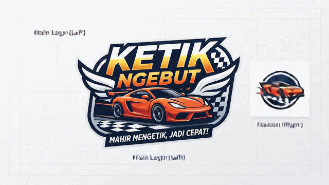
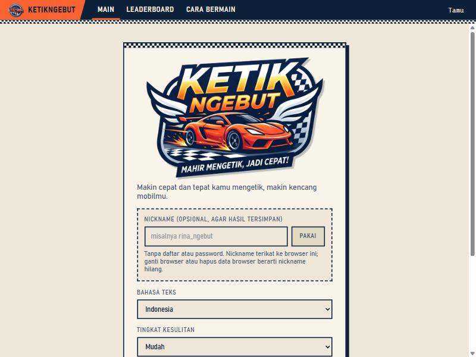
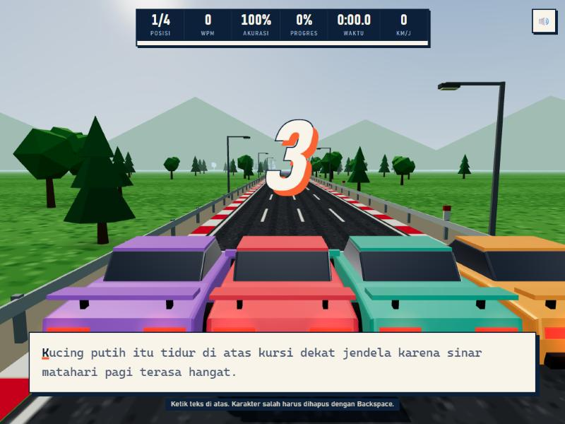
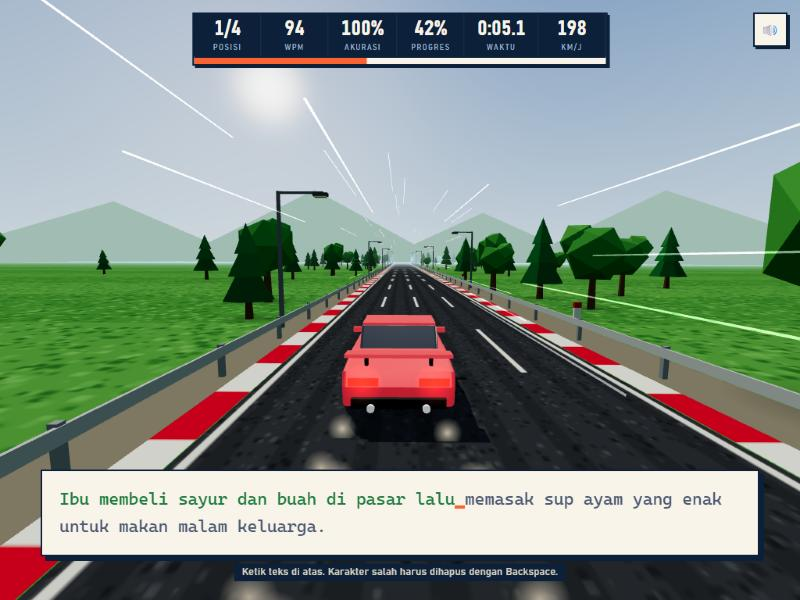
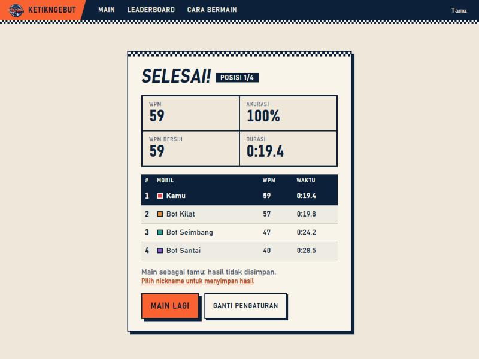

<p align="center">
  
</p>

<h3 align="center">Type fast. Drive faster.</h3>

<p align="center">
  A 3D racing game in the browser where your car is powered by your typing.
</p>

<p align="center">
  <a href="https://ketik-ngebut-speed-typing.my.id">
    
  </a>
</p>

<p align="center">
  <strong>English</strong> · <a href="README.id.md">Bahasa Indonesia</a>
</p>

<p align="center">
  
  
  
  
  
</p>

---

## Why I built this

Touch typing is one of the most useful skills you can practice, but typing drills are boring, and most people
quit before they get fast. **KetikNgebut** ("ketik ngebut" is Indonesian slang for *typing at full speed*)
turns that practice into a race: every correct keystroke pushes your car forward, every typo makes it
stumble, and stopping makes it coast to a halt. Getting better at typing is no longer a number on a
screen; you *see* it and *feel* it.

It is also my learning project. I already knew React and Three.js, and I used this game to learn C#,
ASP.NET Core, Entity Framework Core and server-side security properly: a real backend with a real
anti-cheat problem to solve, instead of another to-do app.

## How it plays

1. **Pick a passage and your opponents.** Indonesian or English text, three difficulty levels, and bots
   from *Beginner* (~28 WPM) to *Advanced* (~72 WPM).
2. **Type when the countdown hits zero.** Your car's speed follows your typing speed over the last few
   seconds. A wrong key turns red and must be fixed with Backspace before you can move on.
3. **Cross the finish line.** See your WPM, accuracy and the final ranking of all four cars. Add a
   nickname to save your results, climb the leaderboard, and race against a *ghost* of your best run.

## Screenshots

| Start screen | Lights out: four cars on the grid |
|---|---|
|  |  |
| **Full speed: the faster you type, the faster you go** | **Results and final standings** |
|  |  |

## Features

- **TypeRacer-style typing engine.** The cursor never moves past a mistake; accuracy and WPM are
  calculated the standard way (5 characters = 1 word).
- **Always four cars.** You versus three bots (one slower, one equal, one faster than the chosen level),
  each with human-like rhythm: uneven key intervals, small pauses, and occasional typos.
- **Ghost mode.** Race against a replay of your own best run, rebuilt from its keystroke log.
- **No sign-up.** Pick a nickname and play. Guests can play too; their results simply are not saved.
- **Fair leaderboard.** Daily, weekly and all-time rankings, one entry per player, with every score
  recalculated by the server.
- **Personal stats.** Average and best WPM, accuracy, and a chart of your progress over time.
- **Weak-key training.** The game tracks which letters you miss most and generates practice text full of
  words that contain them.
- **Sound.** Engine, keystroke and typo sounds generated with the Web Audio API, with a mute button.
- **Settings that follow you.** Language, difficulty, opponent level, car colour and sound are saved per
  nickname (or in the browser for guests).

## Engineering highlights

The parts I am most proud of, and the reasons behind them:

- **One typing engine, two languages, identical results.** The engine is a pure TypeScript module
  (no React, no Three.js). I ported it to C# for the server, and a shared JSON fixture is replayed by both
  Vitest and xUnit. The tests compare floating-point WPM values for exact equality, so the browser and
  the server can never disagree about a score.
- **The server never trusts the client.** A submitted result is only a passage ID and a keystroke log.
  The server replays the log and rejects anything implausible: speeds above a configurable limit,
  keystroke rhythms that are too regular or too fast to be human, tampered timestamps, or logs that do not
  actually type the passage. Rejected results are stored for auditing but never reach the leaderboard.
- **A 60 FPS game loop that does not fight React.** Everything that changes every frame (car physics,
  bot positions, camera) lives in plain objects driven by `requestAnimationFrame`. React only re-renders
  the HUD about ten times per second through small external stores.
- **Identity without passwords.** A nickname is claimed once and bound to the browser by a random secret
  token; the server stores only its SHA-256 hash. Admins use ASP.NET Core Identity with short-lived JWTs
  and rotating refresh tokens that detect reuse.
- **Built for a small server.** The target is a 1 GB VPS shared with other sites, so the stack is one
  .NET process and SQLite in WAL mode, with rate limiting, request size limits and a memory-friendly
  configuration.
- **Tested against the spec.** 276 automated tests (130 xUnit, 146 Vitest). Each test name contains the
  requirement code it verifies, for example `RES_3_Wpm400_DitolakDanTidakMasukLeaderboard`.

## Tech stack

| Layer | Technology |
|---|---|
| Frontend | React 19, TypeScript (strict), Vite, Three.js, GSAP |
| Game logic | Pure TypeScript modules (typing engine, bots, physics), seeded RNG |
| Backend | C# 14, .NET 10, ASP.NET Core Minimal API |
| Data | Entity Framework Core with migrations, SQLite (WAL) |
| Auth | Nickname token (players), ASP.NET Core Identity + JWT (admin) |
| Testing | xUnit + WebApplicationFactory, Vitest + Testing Library |

## Run it locally

Requirements: [.NET 10 SDK](https://dotnet.microsoft.com/download) and [Node.js LTS](https://nodejs.org).

1. Set a development signing key (stored in .NET user-secrets, never in the repository):

   ```powershell
   dotnet user-secrets set "Jwt:SigningKey" "<random string of at least 32 characters>" --project src/KetikNgebut.Api
   ```

2. Start the backend (http://localhost:5288). Migrations run automatically and the passages are seeded:

   ```powershell
   dotnet run --project src/KetikNgebut.Api --launch-profile http
   ```

3. In a second terminal, start the frontend (http://localhost:5173):

   ```powershell
   npm --prefix web install
   npm --prefix web run dev
   ```

4. Open http://localhost:5173 and start typing. The frontend also works without the backend: you can
   play as a guest with the built-in passages.

Deploying to a Linux VPS (systemd, Nginx, HTTPS, backups) is described step by step in
[docs/DEPLOY.md](docs/DEPLOY.md) (in Indonesian).

Run the tests:

```powershell
dotnet test
npm --prefix web test
```

## Project structure

```
src/KetikNgebut.Api              Minimal API endpoints, authentication, rate limiting
src/KetikNgebut.Application      Services, result validation, DTOs
src/KetikNgebut.Domain           Entities and the C# port of the typing engine
src/KetikNgebut.Infrastructure   EF Core DbContext, migrations, Identity
tests/KetikNgebut.Tests          xUnit unit and integration tests
web/                             React + TypeScript + Three.js frontend
shared/fixtures/                 Shared fixture: TypeScript engine == C# engine
docs/PRD.md                      Product requirements (in Indonesian)
```

## Author

Built by **Mustofa** ([@mustofaalatasss](https://github.com/mustofaalatasss)). Feedback and ideas are welcome;
feel free to open an issue.
